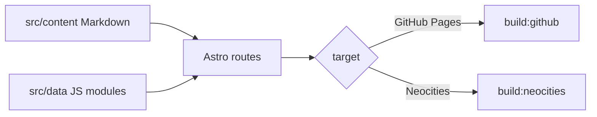

<div align="center">

# Personal

**A personal site that is also a working reference library.**

[](https://adineo-cmd.github.io/personal/)
   

[](https://github.com/adineo-cmd/personal/stargazers) [](https://github.com/adineo-cmd/personal/commits)

[Live site](https://adineo-cmd.github.io/personal/) · [Quick start](#quick-start) · [How it works](#how-it-works) · [Features](#features)

</div>

---

Notes and writings sit next to the things I actually use: training logs,
martial-arts references, mobility systems, a mind/mental-models library,
photography, gear, a 100-goal list and a timeline.

Two build targets ship the same site: GitHub Pages and Neocities.

## Features

| | Feature | What it does |
| --- | --- | --- |
| ✍️ | **Writings and notes** | Long-form pieces and shorter field notes in Markdown. |
| 🥋 | **Training library** | Martial arts, mobility, exercise and home-training references. |
| 🧠 | **Mind** | Mental models and the OmniMind reference set. |
| 🖼️ | **Life archive** | Photos, gear, a family tree, 100 goals and a timeline. |

## How it works

Content and data live apart from presentation:

1. Markdown in `src/content/` holds writings and notes.
2. Plain JS modules in `src/data/` hold structured reference material.
3. Astro routes in `src/pages/` render both through one layout.
4. `build:github` and `build:neocities` run the same Astro build with a
   deployment-specific target, fixing paths and robots.txt for each host.

A `tailwind.config.js` theme and a small component set keep the two targets
identical.



## Quick start

**Develop**

```bash
npm install
npm run dev
```

**Build for a host**

```bash
npm run build:github      # GitHub Pages
npm run build:neocities   # Neocities
```

## Project structure

```text
src/pages/       routes for every section
src/content/     Markdown writings and notes
src/data/        structured reference data
src/components/  shared chrome and cards
public/          images, fonts, robots variants
scripts/         GitHub Pages path fixer
```

## Deployment

Every push to `main` builds the site and deploys it to GitHub Pages
through `.github/workflows/deploy.yml`:

**https://adineo-cmd.github.io/personal/**

## Deployment

Two workflows deploy the same codebase:

- `.github/workflows/deploy-github-pages.yml` → https://adineo-cmd.github.io/personal/
- `.github/workflows/neocities.yml` → the Neocities mirror
